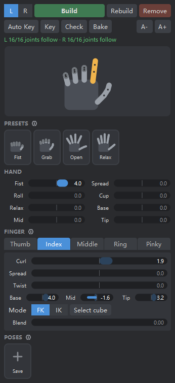

# Finger Master

An overlay finger rig and animation panel for Maya. It adds fist, spread, poses and per-finger IK on top of an existing finger FK rig, and leaves the original rig unchanged.

Maya 2022+ (tested on Maya 2025) · Python 3 · PySide2 / PySide6 · Free for commercial use, modification OK, no redistribution

**Get it on Gumroad (free, pay what you want):** https://sunnysideup73.gumroad.com/l/finger-master



## Features

- One-step setup: select the root joint (or root control) of each finger and click **Build**. Chains, sides and finger names are detected automatically.
- Works with flat (constraint-based) or hierarchical FK rigs, and with referenced rigs.
- The original rig is never edited. Everything is layered through each control's `offsetParentMatrix`, and **Remove** restores the rig exactly.
- Self-check after Build: every joint is tested against the master.
- Hand controls: fist, roll (cascading fist), spread, cup, relax, and base / mid / tip curl.
- Per-finger controls: curl, spread, twist, and per-joint base / mid / tip. Negative values bend the joint backwards.
- Thumb grasp axis can be set to Auto / X / Y / Z, with a flip option.
- Per-finger FK / IK switch. The IK cube snaps to the finger first, so the switch doesn't pop.
- Presets: Fist, Grab, Open, Relax.
- Pose library: save the current hand as a pose. Each pose has a 0–100% weight that you can key and blend.
- Live hand picture: drag fingers or the palm directly. Each finger slider shows that finger's real total.
- Auto Key always keys the whole hand together.
- **Bake** writes the animation back onto the original FK controls, then optionally removes the tool.

<br clear="right">

## Install

1. Download `FingerMaster_vX.Y.Z.zip` from [Releases](../../releases) or [Gumroad](https://sunnysideup73.gumroad.com/l/finger-master) and unzip it.
2. In Maya, open the shelf where you want the button.
3. Drag `install.mel` into the viewport.

A hand icon appears on the shelf. Left-click it to open the panel. Right-click it for Build from selection, the example scene, and Uninstall.

Run without installing:

```python
import sys; sys.path.append(r"<path>/FingerMaster/scripts")
import fingerMaster as fm; fm.ui()
```

## Usage

1. Select the root joint of each finger. Both hands at once is fine.
2. Click **Build**. The top line should read `L 16/16 joints follow`.
3. Animate with the hand picture, presets, sliders and poses.
4. When you are done, click **Bake** to write the animation onto the FK controls.

Building in the rig file before it is referenced is recommended. Building directly on a referenced rig also works.

More detail: [中文说明](package/README.txt) · [日本語](package/README_ja.txt)

## Repository layout

| Path | |
|---|---|
| `fingerMaster.py` | The tool (single file) |
| `package/` | Installer (`install.mel`, `fingerMaster_installer.py`) and user READMEs |
| `test_scene_clean.ma` | Example scene: flat FK controls with constraints and a skinned joint chain |
| `dev/make_package.py` | Builds `dist/FingerMaster_vX.Y.Z.zip` |
| `dev/test_*.py` | Test suites. Run with `mayapy dev/test_xxx.py` |
| `docs/` | Images for this README |

## Tests

```bash
"C:\Program Files\Autodesk\Maya2025\bin\mayapy.exe" dev/test_fingerMaster.py
```

There are 8 suites. They cover a flat constraint rig, joints used as controls, nested controls, rigs that read control values directly, referenced rigs, thumb axis, poses, per-joint bends and bake.

## License

Free to use in personal and commercial projects, including studio and client work. You may modify it for your own or your studio's internal use. Redistributing it, original or modified, is **not permitted**; sharing a link to this repository is fine. Animations and rigs you make with it are yours. See [LICENSE](LICENSE).
